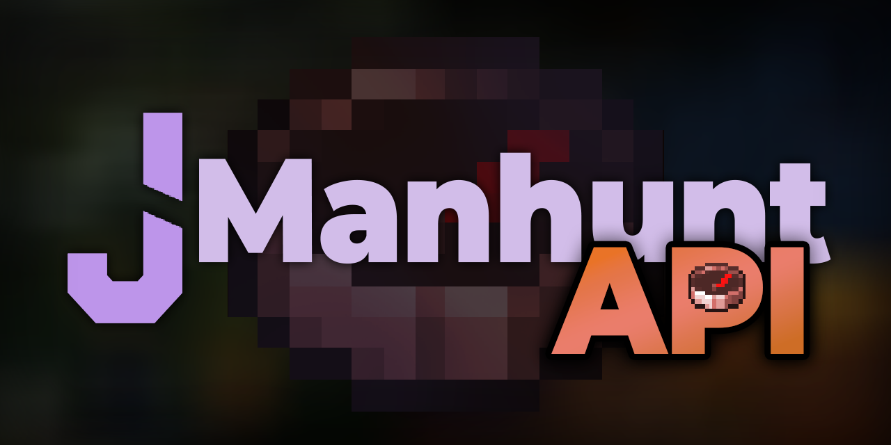

<div align="center">



<h3>Lightweight and extensible API for JManhunt.</h3>

### [Releases](https://github.com/jruk8/JManhunt-API/releases) · [API Docs](https://jruk8.github.io/JManhunt/advanced/api/) · [JManhunt](https://modrinth.com/plugin/jmanhunt)


</div>

# Quick Start 🔌

1. Add the API (`compileOnly`):

```groovy
repositories {
    maven { url = 'https://jitpack.io' }
}

dependencies {
    compileOnly 'com.github.jruk8:JManhunt-API:<tag>'
}
```

2. Require JManhunt in your `plugin.yml`:

```yaml
depend: [JManhunt]
```

3. Look it up and register in `onEnable`:

```java
JManhuntApi.lookup().ifPresent(api ->
    api.registerAddon(this, new ApiVersion(1, 0, 0)));
```

**That's it!** Pin a release tag (`v1.0.0` for the first release), and the services below are ready on the main thread.

### Example

A minimal companion: bonus points per kill, announced when the game begins.

```java
public final class MyAddon extends JavaPlugin implements Listener {
    private JManhuntApi api;

    @Override
    public void onEnable() {
        api = JManhuntApi.lookup()
            .orElseThrow(() -> new IllegalStateException("JManhunt missing"));
        api.registerAddon(this, new ApiVersion(1, 0, 0));
        getServer().getPluginManager().registerEvents(this, this);
    }

    @EventHandler
    public void onBegin(GameBeginEvent event) {
        api.matches().match(event.getMatchId()).ifPresent(match ->
            getLogger().info("Match " + match.matchId()
                + " begun with " + match.runners().size() + " runners!"));
    }

    @EventHandler
    public void onKill(MatchPlayerKillEvent event) {
        api.scores().adjustScore(event.getMatchId(), event.getKillerId(), 10);
    }
}
```

The full reference (services, models, events) lives on the [API docs page](https://jruk8.github.io/JManhunt/advanced/api/).

# Features

- **Live matches** » Read every match, start, fast-forward, and cancel through the same paths as the commands.
- **Players and lobbies** » Roles, participation, and lobby membership, observed live.
- **Compass targets** » What each hunter tracks, with in-game accuracy rules applied.
- **Scores** » Live ledgers plus bonus/penalty adjustments that MVP picks and end reports see.
- **Placeholders** » Resolve `%jmanhunt_*%` keys in code, no PlaceholderAPI dependency.
- **Modifiers** » Toggle modifiers and presets globally, like the operations panel.
- **Events** » Match lifecycle, kills, deaths, combat, progression, and role changes on the main thread.
- **Prepare hooks** » Run async setup before or after the engine's own match preparation via your addon handle.

Unknown ids read as empty (empty optionals, empty collections), never null and never thrown.

# Contributing

See [CONTRIBUTING.md](CONTRIBUTING.md) for the build, versioning, and PR guidelines.

### Requirements

- Server Software » [Paper 26.2+](https://papermc.io/downloads/paper)
- Java Version » **Java 25**
- Engine » **JManhunt** installed (companions also need Paper API itself, `compileOnly`)

### Links

- [Releases](https://github.com/jruk8/JManhunt-API/releases)
- [API Docs](https://jruk8.github.io/JManhunt/advanced/api/)
- [JManhunt](https://modrinth.com/plugin/jmanhunt)
- [Discord](https://discord.com/invite/hkWmCVmWDC)

## License

Dual-licensed: AGPL-3.0 (see [LICENSE](LICENSE)), or MIT for JMH-Premium owners (see [LICENSE-COMMERCIAL](LICENSE-COMMERCIAL)).
